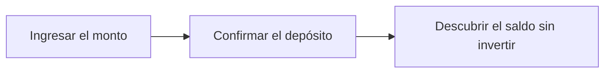
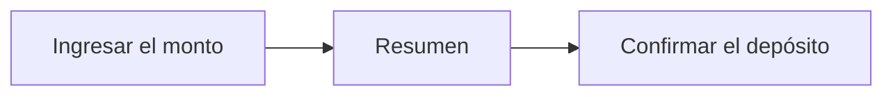

<!--
  CÓMO EDITAR ESTE ARCHIVO
  - El texto es Markdown normal: ## para secciones (arman el índice de la derecha).
  - Los comentarios como este NO se ven en el sitio. Cada "PENDIENTE" marca un hueco
    para una imagen, video o dato. Cuando lo tengas, borra el comentario y pon:
      
    (sube el archivo a static/images/proyectos/racional-resumen-deposito/)
  -  es una imagen de relleno gris: reemplázala por la imagen real.
  - Para un video, igual que una imagen pero con un .mp4 en static/videos/proyectos/racional-resumen-deposito/.
-->

<!-- PENDIENTE · Apertura: mockup cuidado de las pantallas finales, o un video breve del resultado. Fuente: diseños finales. Por producir. -->

## Problema

Al depositar en un portafolio de Racional (una cartera de acciones transadas en Chile), algunas personas descubrían recién después de hacer el depósito que una parte importante de su plata quedaba sin invertirse y no entendían por qué.

<!-- PENDIENTE · Flujo original: bajo cada paso, una nota breve de qué ocurre o qué duda aparece (en el esquema o como texto). Fuente: recorrido original confirmado por la diseñadora. -->

## Objetivo

Queríamos que antes de confirmar el depósito, los usuarios supieran cuánto se invertiría en cada acción, y si parte de su plata iba a quedar sin invertir, que entendieran por qué.

<!-- PENDIENTE · Flujo con resumen: bajo "Resumen", explicar que la persona puede revisar qué se va a comprar y por qué podría quedar plata sin invertir. Fuente: flujo rediseñado. -->

## Research

En pruebas de usabilidad con unos 150 usuarios, vimos que el desglose por acción aportaba poco a principiantes, pero algunos usuarios avanzados necesitaban verlo. Por eso, dejamos la información básica del depósito a primera vista y el desglose a un clic.

::::columnas 2
:::tarjeta
**1. La comisión va primero**

7 de cada 10 quisieron verla antes de confirmar.
:::
:::tarjeta
**2. Ver a dónde va la plata**

La mitad prefirió la pantalla que muestra en qué ETFs se invierte.
:::
:::tarjeta
**3. El riesgo depende de la experiencia**

Lo pidió la mitad de los principiantes y 1 de cada 3 avanzados.
:::
:::tarjeta
**4. "Reinversión de caja" confunde**

Cerca de 3 de cada 10 no la entendió o le sobró.
:::
::::

<!-- PENDIENTE · Pantallazo de la encuesta: una de las preguntas. -->

Se consultó a 111 usuarios reales de Racional qué datos necesitan ver antes de confirmar un depósito. Lo más pedido fue la comisión, y por eso quedó en primera capa. Después, lo que más pesó en la preferencia fue saber en qué se invierte la plata: la pantalla que mostraba los ETFs ganó en principiantes y avanzados por igual. Por eso ese dato se priorizó, y las cuotas y el precio quedaron en el desglose, a un clic, para quien quiera calcular. El riesgo dividió a los usuarios: lo valoraron más los principiantes, y la mayoría de quienes lo pidieron por escrito lo eran. Se dejó visible igual, porque quien recién empieza no sabe que ese dato existe si queda escondido. "Reinversión de caja" fue el dato más difícil de entender, así que se movió al desglose con un texto informativo, idea que propuso un usuario. Finalmente, la forma de pago era lo menos útil para los usuarios y por los datos habría salido de la pantalla. Aun así es un requerimiento de producto, por lo que se mantiene en algunos estados donde corresponde. En todo el estudio, quienes se sintieron menos seguros pidieron más detalle y no menos. Por eso no se eliminó información: se ordenó en capas, con lo esencial a la vista y el resto a un clic.

## Solución

A partir de esos resultados, diseñé e iteré el resumen y el desglose de compra, con revisiones del diseñador senior y del equipo de Producto. Llegamos a dos versiones del resumen, una detallada y otra simplificada.

<!-- PENDIENTE · Flujo completo de la solución: video breve o secuencia de pantallas desde el ingreso del monto hasta la confirmación, mostrando el resumen y cómo se abre el desglose. Fuente: pantallas del flujo final. -->

 y simplificado (derecha)")

<!-- PENDIENTE · Comparación de los resúmenes: una imagen por versión (detallada y simplificada), lado a lado y con el mismo monto, señalando las diferencias verificadas en las pantallas. Fuente: diseños de ambas variantes. -->

## Qué aprendimos

Lanzamos un experimento con tres variantes (el flujo sin resumen, el resumen detallado y uno simplificado). Aún evaluamos si quienes veían un resumen completaban más depósitos y, a largo plazo, hacían menos consultas a soporte y volvían a depositar con mayor frecuencia.

<!-- PENDIENTE · Resultados del experimento: finalización del depósito, consultas a soporte y recurrencia, cuando estén disponibles. -->

<!-- PENDIENTE · Cierre visual: una sola imagen con mockups de las pantallas finales. Fuente: diseños finales. Por producir. -->
